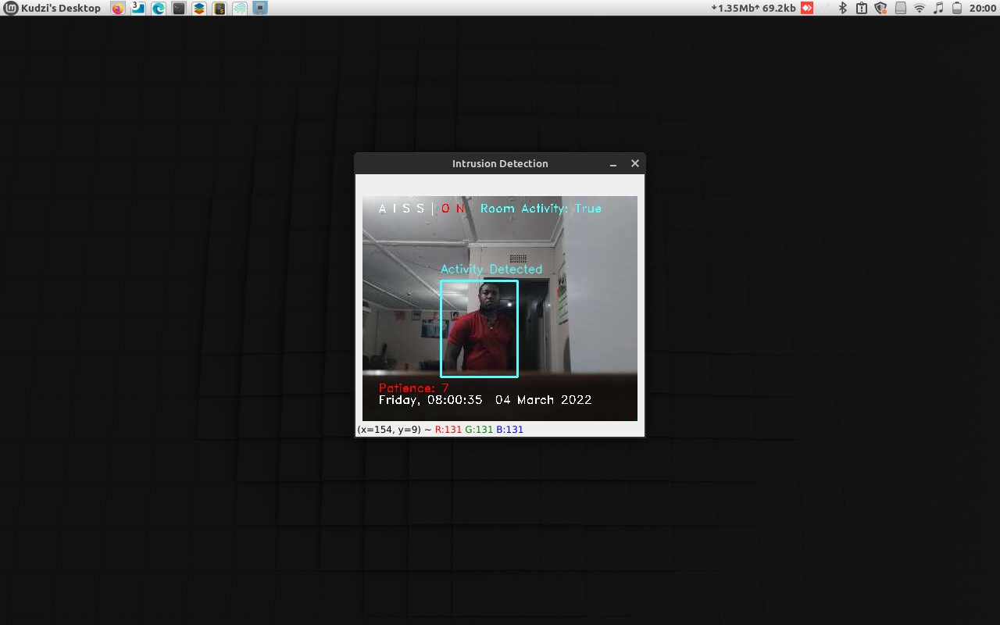
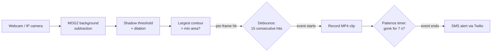
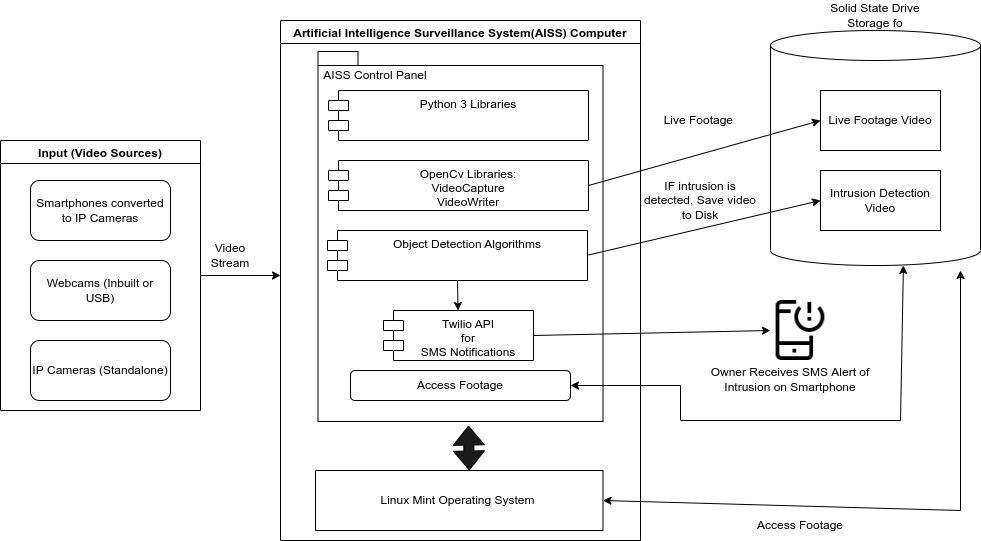
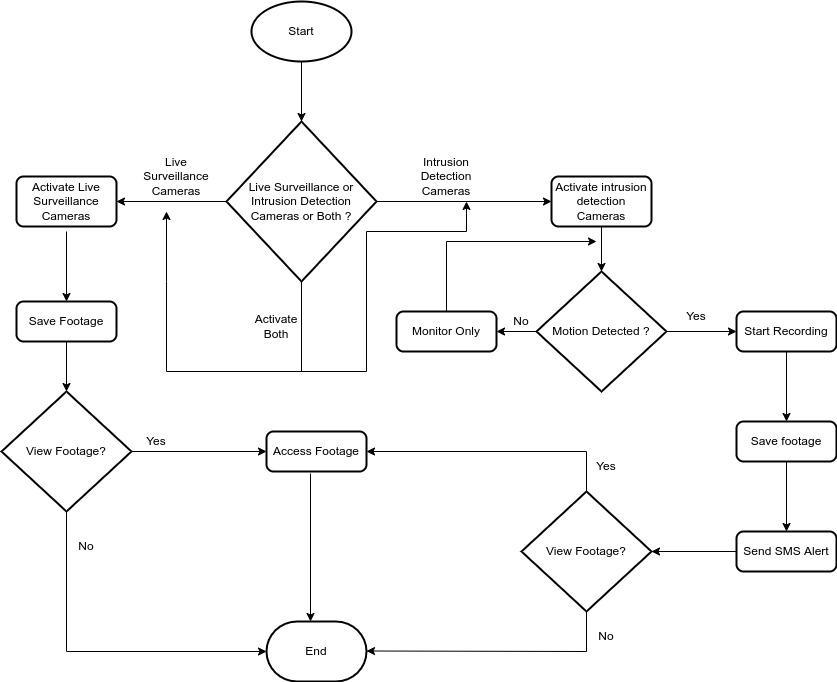
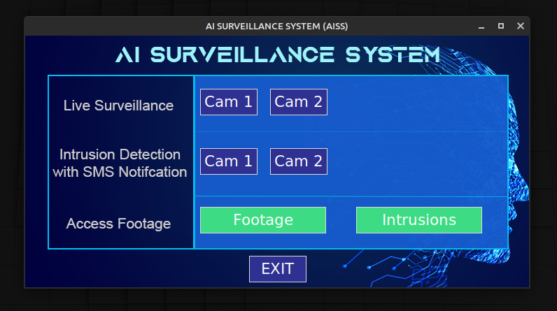
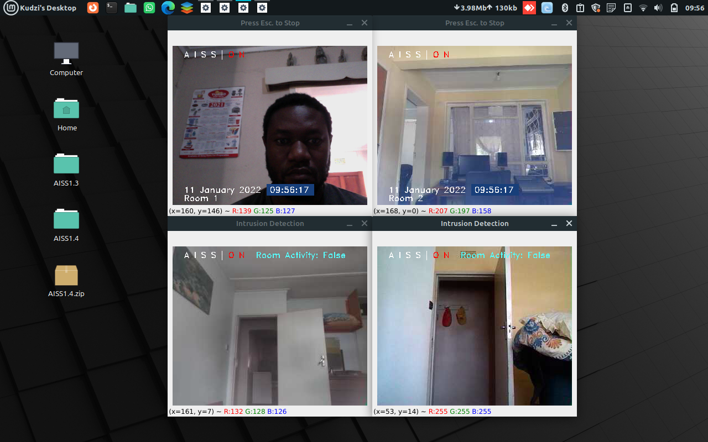
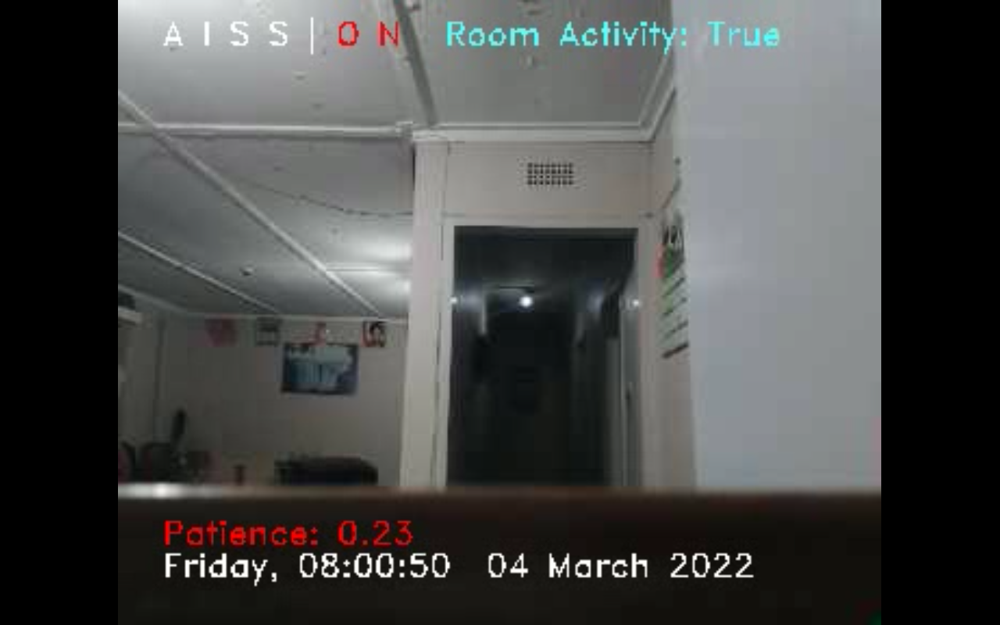
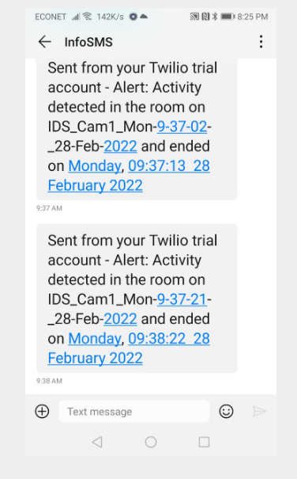

<div align="center">

# 🎥 AISS: AI Surveillance System

**Accessible, low-cost computer vision security: real-time intrusion detection that turns ordinary webcams and smartphones into a smart CCTV network.**

[](https://github.com/kchimbodza/aiss-accessible-vision/actions/workflows/ci.yml)




</div>

---

## Overview

AISS is a computer vision surveillance system I designed, built and field-tested for my
**Bachelor of Information Technology (Honours) research project** at Zimbabwe Open University (2022).
The client was **Cosy Westwood Cottages**, a guest-house business in Harare that had suffered
break-ins and vandalism and could not afford a commercial CCTV installation.

AISS reuses equipment the business already had (a spare laptop, Wi-Fi, webcams and old Android
phones streaming as IP cameras). It does the following:

- **records** every camera continuously, with a timestamped on-screen display
- **detects** intruders in real time with background subtraction and contour analysis
- **saves an evidence clip** of each intrusion, using searchable file names
- **sends an SMS alert** to the owner through the Twilio API when an intrusion ends

### ♿ Accessible by design

Commercial AI surveillance tends to cost too much for small businesses and assume a lot of
technical knowledge. AISS was built to remove those barriers:

- **No new hardware.** It runs on a laptop the client already owned, plus old Android phones
  streaming as IP cameras.
- **Alerts reach any phone.** Notifications are plain SMS, so they work on a basic feature phone
  with no app, smartphone or mobile data needed. That matters in places where data is
  expensive or patchy.
- **No one has to watch screens.** The system does the watching and only raises an alert when
  something happens. It can run unattended.
- **Simple to operate.** One control panel with large, high-contrast buttons. Clips are named by
  camera and time, so non-technical owners can find evidence without scrubbing through footage.
- **Low-bandwidth friendly.** Streams are processed at modest resolutions over local Wi-Fi, and
  nothing is sent to the cloud.

### Results: 100 controlled trials

|                     | Actual activity | No activity |
|---------------------|:---------------:|:-----------:|
| **Alert raised**    | TP = 49         | FP = 3      |
| **No alert**        | FN = 0          | TN = 48     |

| Accuracy | Precision | Recall |
|:--------:|:---------:|:------:|
| **97%**  | **94.2%** | **100%** |

No intrusion was missed. All three false positives happened when a camera was physically bumped.

---

## How it works



1. **Background modelling**: OpenCV's Gaussian Mixture Model (MOG2, Zivkovic 2004/2006) learns
   the static scene, so anything that moves shows up as foreground.
2. **Mask cleanup**: shadow pixels are thresholded out, and morphological dilation merges the
   fragments of a body into one blob.
3. **Contour filtering**: only the largest contour above a minimum area counts, which rejects
   sensor noise and small movements.
4. **Temporal reasoning** (`IntrusionMonitor`): an event starts only after *N consecutive*
   positive frames, and it ends only after the scene has been clear for a *patience* period.
   This keeps alerts from flickering and stops one intrusion from turning into dozens of SMS
   messages.
5. **Concurrency**: each camera runs in its own process, so four streams can be recorded and
   analysed at the same time on one laptop.

<details>
<summary><b>System architecture and flowchart</b> (from the dissertation)</summary>




</details>

---

## Screenshots

| Control panel | Four concurrent streams |
|:---:|:---:|
|  |  |
| **Patience timer counting down** | **SMS alert on the owner's phone** |
|  |  |

---

## Quick start

```bash
git clone https://github.com/kchimbodza/aiss-accessible-vision.git
cd aiss-accessible-vision
python -m venv .venv && source .venv/bin/activate
pip install -e .

cp .env.example .env        # set camera sources and (optionally) Twilio keys
aiss                        # launch the control panel
```

You can also run each part on its own from the command line:

```bash
aiss live   --source 0                                   # record webcam 0
aiss detect --source http://192.168.1.104:8080/video     # watch a phone streaming as an IP camera
aiss detect --source hallway.mp4 --no-display            # analyse a recorded video headlessly
aiss detect --source 0 --min-area 1500 --confirm-frames 10 --patience 5
```

If Twilio isn't configured, alerts are written to the console instead, so you can try the
system without an account.

### Configuration (`.env`)

| Variable | Default | Description |
|---|---|---|
| `AISS_CAM1`, `AISS_CAM2` | `0`, unset | Webcam index or IP-camera stream URL |
| `AISS_FRAME_SIZE` | `640x480` | Processing and recording resolution |
| `AISS_FOOTAGE_DIR` / `AISS_INTRUSIONS_DIR` | `footage` / `intrusions` | Output folders |
| `TWILIO_ACCOUNT_SID`, `TWILIO_AUTH_TOKEN`, `TWILIO_FROM_NUMBER`, `ALERT_TO_NUMBER` | unset | SMS alerts |

Recordings are named by type, camera and time (for example `LS_Cam1_…mp4` for live
surveillance and `IDS_Cam2_Mon-09-37-02_28-Feb-2022.mp4` for an intrusion). This makes
evidence easy to find without scrubbing through hours of footage.

---

## Project structure

```
aiss/
├── detector.py   # MotionDetector (CV) + IntrusionMonitor (debounce / patience state machine)
├── pipeline.py   # live-recording and intrusion-detection camera loops
├── overlay.py    # on-frame HUD (status, patience timer, timestamp, bounding boxes)
├── notifier.py   # non-blocking Twilio SMS, falls back to console logging
├── gui.py        # Tkinter control panel, one process per camera
├── config.py     # .env / environment configuration
└── cli.py        # `aiss gui | live | detect`
tests/            # unit tests + end-to-end test on a synthetic video (runs in CI, no camera needed)
legacy/           # original 2022 v1.4 source, kept for reference
```

## Testing

```bash
pip install -e ".[dev]"
pytest -v
```

The tests generate synthetic frames and a synthetic video, so the detector, the state machine and
the full record-and-alert pipeline can all be checked in CI without camera hardware.

---

## Version history

- **v1.4 (2022)**: the version delivered for the dissertation (see [`legacy/`](legacy)).
- **v2.0 (2026)**: refactored into a tested Python package with a CLI and CI. This version:
  - moves secrets out of the source code and into `.env`
  - replaces four copy-pasted camera loops with one reusable pipeline
  - sends SMS alerts without blocking the video loop
  - works across platforms (Linux, macOS and Windows)

## Future work

- Replace motion-based detection with a deep-learning person detector (e.g. YOLO / MobileNet-SSD)
  to ignore pets and lighting changes
- Image stabilisation to remove the false positives caused by bumped cameras
- Web dashboard and cloud backup of intrusion clips

## Acknowledgements

- Supervisor: Ms S. Ruzvidzo, Zimbabwe Open University
- The intrusion-detection loop and the Tkinter control panel started from public OpenCV
  learning tutorials (Bleed AI's intruder-detection tutorial and the `smart-cctv-tkinter`
  project). I then adapted them for multiple cameras, the client's requirements and field testing.

## Author

**Kudzayi Chimbodza**: [GitHub @kchimbodza](https://github.com/kchimbodza)

Licensed under the [MIT License](LICENSE).
